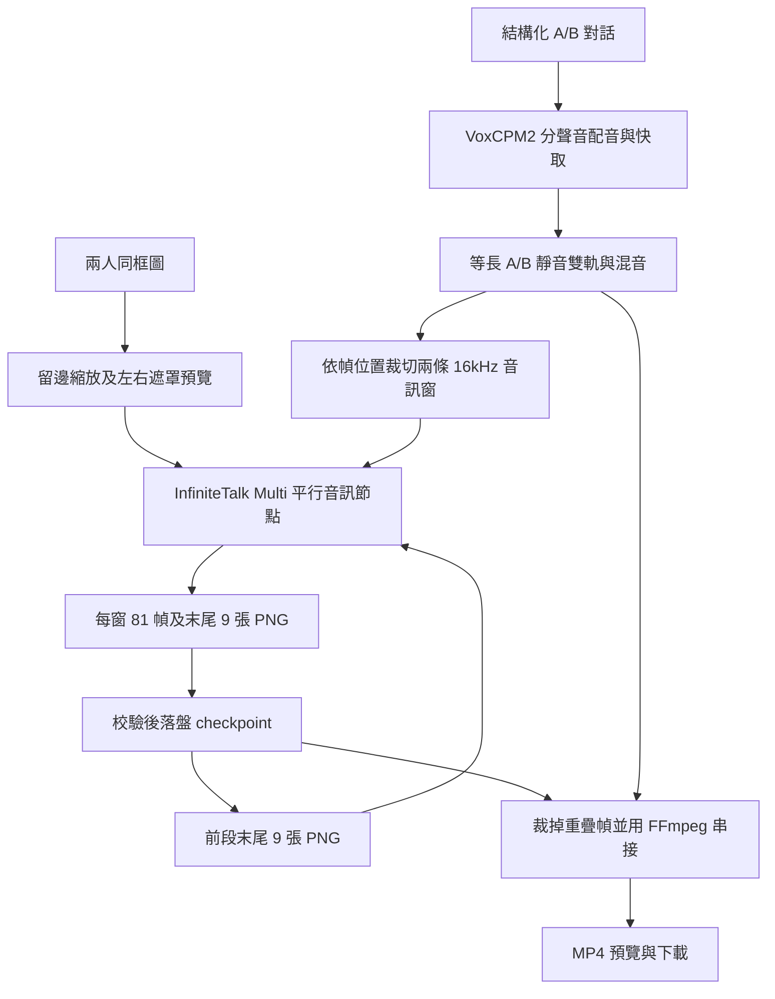

# 架構與原始碼核對

## 固定來源

- 參考 Notebook：`dawang-sakura/colab-talking-avatar@cd18c818a50a9d3c3deb5d1c7eed71e639ae5c59`。
- ComfyUI：`v0.43.0`，commit `426f5eea52a7ece1dd599fff4cb6cd1f352ddd24`。
- VoxCPM 程式：`cce58a5b59303c9bd63d12f23afe6a49a4a80c59`；VoxCPM2 權重：`32279effe8c19989596f05d353d1447f51d9e915`。
- 六個 Comfy 模型的完整路徑、revision、檔案大小與 SHA-256：`configs/models.lock.json`。
- 程式依賴沿用原始 Notebook 的 Comfy 與 Vox commit；上游 requirements 並未鎖死全部間接依賴。安裝時分離 TTS／Comfy venv，記錄各自 pip freeze，不宣稱完整環境已在 Colab 重現。

## 流程

## 為何需要衍生節點

[nodes_wan.py 固定版](https://github.com/Comfy-Org/ComfyUI/blob/426f5eea52a7ece1dd599fff4cb6cd1f352ddd24/comfy_extras/nodes_wan.py) 的 `WanInfiniteTalkToVideo`（1463–1624 行）宣告：

| 項目 | API 輸入／輸出 |
|---|---|
| 雙人模式 | `mode="two_speakers"` |
| A 音訊特徵 | `audio_encoder_output_1` |
| B 音訊特徵 | `mode.audio_encoder_output_2` |
| A/B 遮罩 | `mode.mask_1`、`mode.mask_2` |
| 圖片 | `start_image` |
| 動作續接 | `previous_frames`、`motion_frame_count=9` |
| 輸出索引 | 0 model、1 positive、2 negative、3 latent、4 trim_image |

DynamicCombo 的巢狀參數在 HTTP prompt 中使用點號前綴，非 Python 呼叫中的 dict，也不是平面 `mask_1`。
依據 `_io.py` 的 `finalize_prefix`／`DynamicCombo._expand_schema_for_dynamic`。
`SaveVideo` 同理使用 `format="mp4"`、`format.codec="h264"`。

原始節點的 `multi_audio_type="add"` 會將兩條特徵串成兩倍長，B 在 A 全長之後開始。
因此不能將含靜音的兩條完整音軌直接交給原始節點。衍生節點只改類別／node ID 與 `multi_audio_type="para"`，保留上游既有等長補齊分支。
AST 測試驗證除此之外沒有改變原始節點運算；單元測試直接執行衍生節點的音訊排列程式區塊。
這項修正的推論品質仍須 GPU 測試，沒有將單元測試當成模型有效性的證據。

遮罩透過 `LoadImageMask(channel="red")` 載入，白色為有效區域；不使用 alpha 反相語意。
預設左右半幅適用於人物不跨越中心的圖片；自訂遮罩需在輸出座標系統中包含各自頭部及上半身。

## 續接時間座標

原始節點的音訊起點是 `len(previous_frames) - motion_frame_count`。
本專案每次只載入前段最後 9 張 PNG，故節點內起點為 0；外部預先依全域幀位置裁切 A/B 音訊。

| 段 | 全域音訊窗開始幀 | 產生幀數 | 裁除開頭 | 新增有效幀 |
|---|---:|---:|---:|---:|
| 0 | 0 | 81 | 0 | 81 |
| 1 | 72 | 81 | 9 | 72 |
| 2 | 144 | 81 | 9 | 72 |

最後一段裁到 `ceil(audio_samples × 25 / sample_rate)`，再以原始音軌時長封裝。
允許尾端最多一幀視訊量化及 AAC 封包補齊，測試不要求容器時長逐取樣完全相等。
每段獨立 wav2vec 特徵編碼與 8-bit PNG 動作參考可能影響接縫；未主張與一次完整特徵編碼／浮點動作參考等價。

## 失敗與恢復

每段完成後保存 raw.mp4、clip.mp4、9 張 PNG、workflow.json、history.json、complete.json。
checkpoint 包含內容雜湊；run signature 包含素材、設定、模型 lock 與程式內容。修改設定需新 RUN_NAME。
若中間一段損毀，從該段起與其依賴的後續片段一起重算，不會把新舊動作鏈混用。
ComfyUI 使用 `--cache-none` 限制跨段影像快取累積；一次只提交一個片段。
請勿同時啟動兩個 Notebook 寫同一 RUN_NAME；這不是多程序工作排程器。
